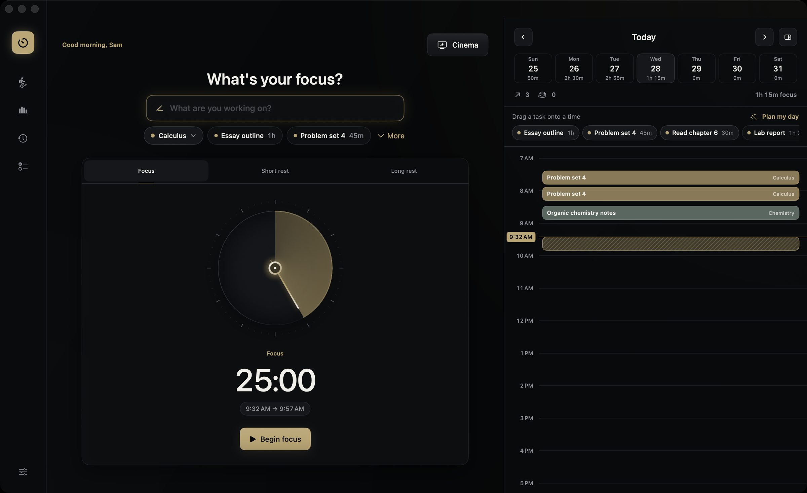
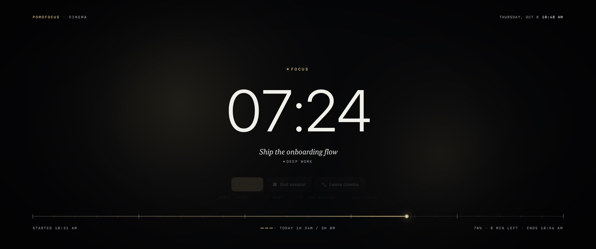

# Pomofocus

Pomofocus is a beautiful, local-first focus timer for macOS. It brings together clear intentions, flexible intervals, breaks, reflection, and useful analytics—without accounts, subscriptions, tracking, or cloud infrastructure.

> Piano piano. One meaningful thing at a time.

**[Download for Mac](https://github.com/CryptoChefA/pomofocus-mac/releases/latest/download/Pomofocus.zip)** · **[Website](https://cryptochefa.github.io/pomofocus-mac/)** · macOS 14+ · Apple silicon · free and open source





## Install

1. [Download `Pomofocus.zip`](https://github.com/CryptoChefA/pomofocus-mac/releases/latest/download/Pomofocus.zip) and unzip it.
2. Drag **Pomofocus** into **Applications**.
3. The build isn't notarized by Apple, so macOS blocks the first launch. Open **System Settings → Privacy & Security** and choose **Open Anyway**, or run:

   ```sh
   xattr -dr com.apple.quarantine /Applications/Pomofocus.app
   ```

## What works today

- Native SwiftUI macOS app and menu-bar timer with a live progress ring and countdown
- Native small, medium, and large desktop/sidebar widgets with a live timer and one restrained gold progress band
- Obsidian Atelier interface with graphite surfaces, champagne accents, and precision typography
- Themes: Obsidian, Ivory (light), Midnight, Forest, Ember, Sakura, Layla (Tiffany baby pink) and Écrin (jewel-box red and gold), Match system (follows macOS light/dark), or a custom theme built from a base, a background, a focus colour and a break colour; readable surfaces are derived automatically. Chosen on first launch and changeable in Settings
- Split focus workspace with an analog timer dial and a dark daily timeline
- Cinema mode (⇧⌘F): a full-screen, screensaver-like scene for wide and ultrawide displays, with rolling digits, an unrolled minute tape, and a slowly drifting glow; keeps the display awake, Space pauses, → advances, Esc leaves
- Seven-day navigator with focus, break, and live-session blocks
- Break records with planned duration, actual duration, skipped status, and tracked overtime
- Custom focus, short-break, and long-break durations
- Pause, resume, finish early, abandon, automatic breaks, and open-ended overtime
- End session (⌘.) in every state, including breaks and the Next prompt: keeps everything tracked and stops without starting anything new; Abandon now asks before discarding
- Configurable overtime reminder chime with one-click Next into the upcoming break
- Cockpit-style overtime alert: the time, status tag, and menu-bar item flash caution red (steady red with Reduce Motion, and switchable in Settings)
- Break-complete reminder with one-click Next straight into the next focus block
- Visible Skip break action that immediately begins the next focus session
- Keep tasks simple (on by default): Tasks opens on Today with one Up next task and Start focusing, adding a task is just its name, there are no hour totals or colour pickers, a gentle nudge after five minutes of planning, and the day planner folds away while a block runs; turn it off in Settings for the full board
- Bring your work into Tasks: after updating, a one-time offer turns what you've timed (and your lists) into tasks; recent, repeated work is ticked, everything else is left for you to choose
- Updates that respect a running block: the timer keeps counting through an in-app update, and What's New waits until the block ends
- Tasks: a New task button (⇧⌘N) asks what, which list, how long (15m to 3h) and when; or type straight into any list and press Return, and the app asks how long it will take
- All lists board: every list (a class, a project) as a card with its tasks underneath and an add line in each card; click a task to edit it, drag it onto another card to move it
- Today, Upcoming and Completed views, plus your own colour-coded lists with open counts and estimated time; renaming and archiving from the sidebar
- Paste a list: paste or type a whole list in plain text (bullets, checkboxes, and lines like “Chemistry:” that start a list) with a live preview, then add it all at once
- Start a focus block from any task; its focus time counts toward the task (“52m of 1h 40m”), the timer shows what you're working on, and the celebration lists what you checked off
- Lifetime focused hours and session count for every list
- Total focus time, distinct usage days, current streak, and longest streak
- Fourteen-day activity chart and twelve-week consistency heatmap
- Focus score: one number out of 100 for each day (time against your goal, finishing what you start, few pauses, breaks back on time, your longest unbroken stretch), with a 7-day comparison; click it to see exactly why, part by part, with the one change that would lift it most
- Away guard: if a timer runs over and you leave the Mac (no keyboard or mouse for 10 minutes, sleep, lock, or the app closed), it pauses as of when you left, so a forgotten timer doesn't record hours of overtime; "I was here" counts the time anyway; old runaway timers can be trimmed from the dashboard
- Clickable dashboard metrics with dedicated 7, 30, and 90-day intelligence views, rolling trends, outcome distributions, task allocation, time-of-day patterns, and transparent metric definitions
- Insights with a 7, 30, 90-day or all-time range: week-over-week trend, six-month totals, daily goal hit rate, focus by hour and weekday, rating by task and start hour, completion rate, focus-to-break ratio, skipped breaks, and overtime trend
- Read-only calendar overlay on the day timeline through EventKit, so any account added to macOS (Google included) appears behind your sessions, with a per-calendar picker and Start focus from an event
- Intention for each focus block
- One-click session rating (Scattered, Restless, Steady, Focused, Flow) at the end of a whole session, or after every block if you prefer; it sits beside the session in History and feeds Insights
- Focus rebuild plan: eight questions build a research-based plan in four phases (Reset, Build, Extend, Sustain). Blocks climb five minutes per level once you finish 4 full blocks on 2+ days with a 70% completion rate, and step back a level if under 40% are finished. Weekly metrics (completion rate, longest unbroken stretch, pauses per block, start-time spread, active days), house rules from your distractions, a restorative break menu and an end-of-day reward; every recommendation cites peer-reviewed research, with a Sources page and an honest note on what the science doesn't say
- Collapsible day timeline (⌥⌘T)
- Session celebration: when you press End session, screen-wide confetti and a cinematic breakdown of the whole sitting (every pomodoro, total focus, breaks, pauses, overtime, today vs goal, streak); single pomodoros pass quietly; switchable in Settings
- Three-cycle guided breathing ritual with animated inhale and exhale cues
- Local notifications and a locally generated bell ding for every timer cue
- Local focus ambience: soft ticking, layered natural rain, ocean waves, and brown noise
- Ambient volume, four-second preview, and automatic pause/resume with the timer
- Configurable daily goal and presence chime
- Searchable history and CSV export
- Timer recovery after quitting or restarting the app
- Human-readable local JSON storage
- Custom keyboard shortcuts and menu-bar controls

## Privacy

Pomofocus has no account system, telemetry, advertisements, analytics SDK, or networking code. The optional calendar overlay reads events that macOS already syncs to your Mac. macOS only offers full calendar access or none, so the system prompt says "full access", but the app contains no code that creates, edits, or deletes events. Its database lives at:

```text
~/Library/Application Support/Pomofocus/pomofocus-data.json
```

The Settings screen can reveal this file in Finder. Back it up, inspect it, transform it, or delete it whenever you choose.

Images attached to past sessions are stored locally beside it in:

```text
~/Library/Application Support/Pomofocus/Images/
```

Existing Pomodoro Nonna data is migrated into these paths automatically on the first Pomofocus launch.

## Run from source

Requirements: macOS 14 or newer and a Swift 6.2 toolchain (Xcode 26 or its Command Line Tools).

```sh
swift run
```

## Build the macOS app

```sh
chmod +x Scripts/build-app.sh
Scripts/build-app.sh
open "outputs/Pomofocus.app"
```

The script makes `outputs/Pomofocus-<version>.zip`, containing a local ad-hoc-signed application and its WidgetKit extension with stable designated requirements, plus an unpacked development copy. Keeping the app requirement stable prevents macOS calendar consent from being lost between local updates. The ZIP is the canonical local release because some file-provider folders attach metadata directly to exposed app bundles. A public release should use an Apple Developer ID and notarization.

Builds from this script are ad-hoc signed, not notarized. A build you make yourself opens normally; a downloaded one needs the **Open Anyway** step from [Install](#install).

The bundle identifiers (`org.pomodorononna.app` and `org.pomodorononna.app.widget`) live in `Resources/Info.plist`, `Resources/WidgetInfo.plist`, and `Scripts/build-app.sh`. Change all three if you ship your own fork.

## Check the analytics engine

The current command-line Swift installation does not bundle XCTest, so the core analytics checks are intentionally dependency-free:

```sh
mkdir -p .build/checks
swiftc Sources/PomodoroNonna/Models.swift Sources/PomodoroNonna/TodoModels.swift Sources/PomodoroNonna/FocusPlan.swift Sources/PomodoroNonna/FocusScience.swift Sources/PomodoroNonna/ThemePalette.swift Sources/PomodoroNonna/Insights.swift Sources/PomodoroNonna/DeepDiveAnalytics.swift Tests/AnalyticsCheck/main.swift -o .build/checks/analytics-check
.build/checks/analytics-check
swiftc Sources/PomodoroNonna/Models.swift Sources/PomodoroNonna/TodoModels.swift Sources/PomodoroNonna/FocusPlan.swift Sources/PomodoroNonna/FocusScience.swift Sources/PomodoroNonna/ThemePalette.swift Sources/PomodoroNonna/WorkImport.swift Tests/FocusPlanCheck/main.swift -o .build/checks/focus-plan-check
.build/checks/focus-plan-check
swiftc Sources/PomodoroNonna/ThemePalette.swift Sources/PomodoroNonna/ThemeCodes.swift Tests/ThemeCheck/main.swift -o .build/checks/theme-check
.build/checks/theme-check
swiftc Sources/PomodoroNonna/TodoModels.swift Tests/TodoCheck/main.swift -o .build/checks/todo-check
.build/checks/todo-check
swiftc Sources/PomodoroNonna/Models.swift Sources/PomodoroNonna/TodoModels.swift Sources/PomodoroNonna/FocusPlan.swift Sources/PomodoroNonna/FocusScience.swift Sources/PomodoroNonna/ThemePalette.swift Sources/PomodoroNonna/FocusScore.swift Tests/FocusScoreCheck/main.swift -o .build/checks/focus-score-check
.build/checks/focus-score-check
```

## Architecture

- `AppModel.swift`: timer state machine, local session lifecycle, notifications, and sound lifecycle
- `AmbientSoundPlayer.swift`: locally generated, looping ambient soundscapes
- `CueSoundPlayer.swift`: locally generated bell ding for timer cues
- `Models.swift`: persistent records and pure analytics calculations
- `TodoModels.swift`: tasks, due dates, and the quick-add / pasted-notes parser
- `Insights.swift`: pure, range-filtered insight calculations (trends, time of day, quality, breaks)
- `InsightsView.swift`: the Insights section of the dashboard
- `DeepDiveAnalytics.swift`: 7/30/90-day intelligence calculations for dashboard drill-downs
- `MetricDeepDiveView.swift`: interactive metric detail sheets with rich charts and explanations
- `ChartHover.swift`: hover tooltips shared by every chart
- `CalendarStore.swift`: read-only EventKit access for the timeline overlay
- `LocalStore.swift`: atomic JSON persistence in Application Support
- `WidgetSnapshotWriter.swift`: private local timer snapshots and WidgetKit refreshes
- `PomofocusWidget.swift`: small, medium, and large macOS widget layouts
- `FocusView.swift`: main focus ritual and the one-click session rating
- `FocusCanvasView.swift`: local text, pasted images, captions, resizing, and ordering
- `CinematicMode.swift`: full-screen Cinema scene, with Core Animation backdrop and minute tape
- `CelebrationMode.swift`: end-of-sitting confetti and stats breakdown
- `FocusPlan.swift`: the focus plan engine (ladder, evidence-based levelling, phases, metrics, rules, break menu)
- `FocusScience.swift`: the citations behind the plan and the limits of the evidence
- `FocusPlanView.swift`: the Plan section and its questionnaire
- `ThemePalette.swift`: theme palettes, presets and custom-theme colour derivation
- `ThemePickerView.swift`: the theme picker, custom theme editor and first-launch welcome
- `DashboardView.swift`: local charts, lifetime task totals, streaks, and usage days
- `FocusScore.swift`: the daily focus score and runaway-timer trimming (pure, tested); `FocusScoreViews.swift` draws them
- `HistoryView.swift`: searchable session ledger and CSV export
- `TasksView.swift`: Tasks (board, smart views, New task form, Paste a list) and the timer's task link
- `SimpleTasks.swift`: the Keep tasks simple Today view (Up next, planning nudge)
- `WorkImport.swift`: picks past work to offer as tasks after updating (pure, tested); `WorkImportSheet.swift` shows the offer
- `SettingsView.swift`: timer, rhythm, sound, and privacy controls

## Roadmap

The project deliberately starts with a reliable focus and analytics core. Suitable next releases include:

- Local distraction shield for selected macOS apps
- Optional open-source Safari/Chromium website-blocking extension
- Local calendar export
- Editable sessions and JSON import/export
- Task estimates and a lightweight “Today” queue
- Per-task profiles for intervals, sounds, and blocklists
- Additional locally generated ambient soundscapes
- Accessibility audit, localization, and full keyboard navigation
- Universal binary, Developer ID signing, notarization, and packaged releases

See [CONTRIBUTING.md](CONTRIBUTING.md) before proposing a change.

## Updating

Your sessions, tasks and settings stay on your Mac and are kept when you update.

- **Version 0.22.1 or newer:** Pomofocus updates itself. When a new version is out it shows **Pomofocus is ready**; click **Update now**. To check yourself, choose **Pomofocus → Check for Updates** or **Settings → Updates → Update Pomofocus**.
- **Version 0.22.0 or older:** quit Pomofocus, download [Pomofocus.zip](https://github.com/CryptoChefA/pomofocus-mac/releases/latest/download/Pomofocus.zip), unzip it and drag Pomofocus into Applications, choosing **Replace**. From then on it updates itself.
- **Which version do I have?** The top line of **Settings** says.

## Theme codes

Anyone can share a custom theme: **Settings → Appearance → Build your theme → Share this theme** copies a code, and pasting it into **Paste a theme code** adds it.

Rare themes come from codes signed with the developer's private key, which never leaves the developer's Mac (`~/.pomofocus-dev/rare-theme-key`). The app only contains the public key, so it can check a rare code but can't make one. To make one:

```bash
swift Scripts/mint-rare-theme.swift --name "Garden" --note "For a friend" --light --background FBE9EE --accent C96B86 --rest 9E4A64
```

## Sound credits

The focus sounds in `Resources/Sounds` come from Wikimedia Commons, trimmed into seamless loops:

- `clock.m4a`: "Wall clock with weight ticking" by Work With Sounds / Technical Museum of Slovenia, [CC BY 4.0](https://creativecommons.org/licenses/by/4.0/) ([source](https://commons.wikimedia.org/wiki/File:WWS_Wallclockwithweightticking.ogg)).
- `rain.m4a`: "Rain against the window", public domain ([source](https://commons.wikimedia.org/wiki/File:Rain_against_the_window.ogg)).
- `ocean.m4a`: "Ocean Waves on a Tropical Beach", CC0 ([source](https://commons.wikimedia.org/wiki/File:Ocean_Waves_on_a_Tropical_Beach.ogg)).
- `brown.m4a` and `white.m4a` are generated noise, made for Pomofocus.

## License

MIT. Use it, fork it, improve it, and keep focus tools available to everyone.
